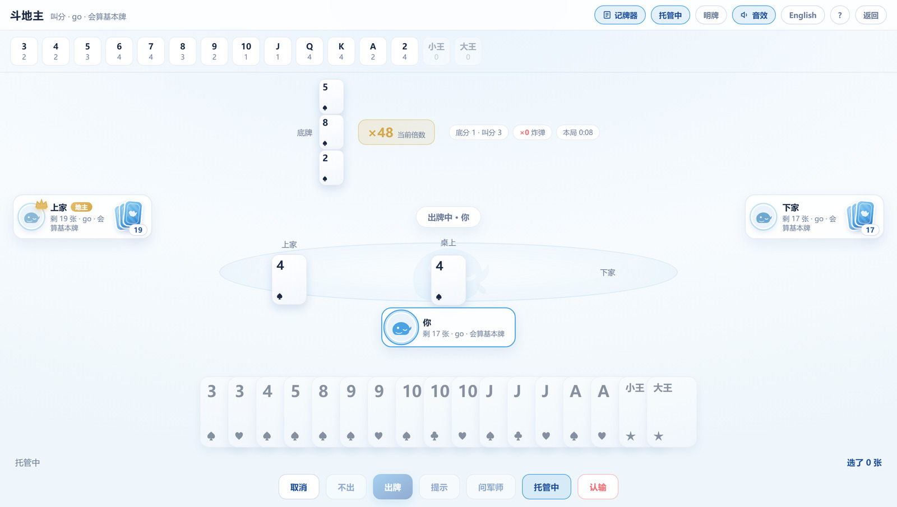
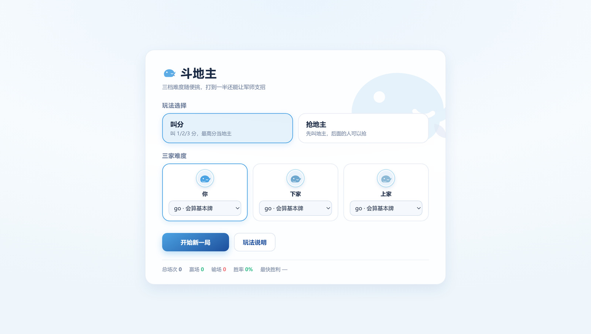
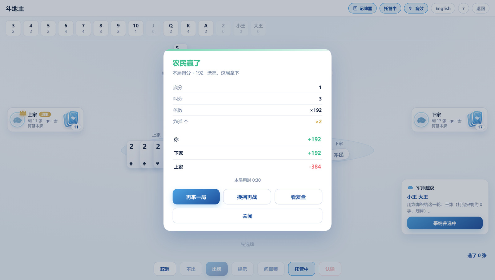

<div align="center">

# 斗地主 · DSH 插件

在 DeepSeek Harness（DSH）侧栏里直接开一局斗地主：和两个 AI 打，
七档难度、叫分/抢地主、加倍明牌、记牌器、军师建议、完整结算与复盘。


</div>



<table>
<tr>
<td width="50%"></td>
<td width="50%"></td>
</tr>
</table>

## 这是什么

一个纯前端的 DSH 插件。装上之后，左侧「更多」菜单里会多一行**斗地主**，点开占满主区，
你和两个 AI 各坐一角打完一整局。牌局完全在本地推演，不联网、不注入任何游戏客户端。

不只是"能出牌"：

- **七档 AI**，三家可以各选各的（下家 `pro500`、上家 `go` 也完全没问题）
- **叫分 / 抢地主** 两种开局玩法，定地主后三家同时 **加倍**，还能 **明牌**（三家手牌亮出来）
- **记牌器** 顶栏常驻，随时知道还剩几张 2、几张王
- **军师建议**：给出推荐牌型 + 一句话理由 + 估计胜率，可以直接"采纳并选中"
- **复盘**：结算后能上一步/下一步手动翻完整局
- 30 秒倒计时、提示循环、托管、音效开关、中英双语、跟随系统深浅色

## 玩法

| 阶段 | 说明 |
|---|---|
| 叫分 | 不叫 / 1 / 2 / 3 分，最高者当地主；三家都不叫就重新发牌。开局也能切到「抢地主」玩法 |
| 加倍 | 定地主后三家同时选：不加倍 / ×2 / 超级加倍 ×4；明牌每家再 ×2 |
| 出牌 | 点牌选中（按住滑动可连选），「出牌」下牌、「不出」过牌、「提示」循环给可出牌、「问军师」看出牌建议 |
| 结算 | 底分 1 × 叫分/加倍 × 明牌 × 炸弹（每个 ×2）× 春天/反春 ×2 |
| 复盘 | 结算里「复盘」可以上一步/下一步手动翻整局 |

牌型按常见规则：单张、对子、三张、三带一/二、顺子（5 张起）、连对（3 对起）、飞机带单/带对、
四带两单/四带两对、炸弹、王炸（最大）；2 和大小王不进顺子/连对；三带一允许带单王。

## 七档难度

三家分别选，互不影响；托管时用你自己的档位代打。

| 档位 | 思路 |
|---|---|
| `free` | 乱打：多数时候随机出合法牌，练手用 |
| `go` | 规则启发式：记牌、配合队友、顶牌、不乱开炸 |
| `plus` | `go` + 12 次局面推演，微调选牌 |
| `pro100` | 推演 100 次 |
| `pro200` | 推演 200 次 |
| `pro500` | 推演 500 次（单步可能到 0.8 秒） |
| `pro9999` | 一直推演到 4 秒为止，最强也最慢（牌桌会显示「思考中…」） |

## 安装

需要 Node ≥ 20 和一个已经能跑起来的 DSH。

1. 把 `plugin/dsh-doudizhu-game` 整个目录放到 `~/.dsh/plugins/dsh-doudizhu-game`
2. 在 `~/.dsh/profiles/desktop/package.json` 的 `dependencies` 里加一行：
   ```jsonc
   "dsh-doudizhu-game": "link:C:/Users/<你>/.dsh/plugins/dsh-doudizhu-game"
   ```
3. 同一个文件的 `dsh.profile.bundles` 数组里加 `"dsh-doudizhu-game"`
4. 重启 DSH 宿主，刷新页面

`client.js` 已经是从 `src/` 打好的单文件产物，纯客户端插件，跑起来不需要构建服务，
也不需要装 npm 依赖。

## 开发

```bash
cd plugin/dsh-doudizhu-game
node build.mjs               # src/{engine,game,i18n,style,ui}.js -> client.js
node test/game.test.mjs      # 规则核心：发牌 / 叫分 / 倍数 / 结算 / 300 局自对局
node test/render.test.mjs    # 假 React 渲染自测：注册 / 开局 / 托管整局 / 结算 / 再来一局
node test/check-keys.mjs     # 文案与 API 引用检查
node test/host-boot.test.mjs # 宿主加载自测
```

改界面不用装 DSH：`demo/index.html` 用最小的 `__ModuleLoader__` + `slots` 桩把
`PanelView` 直接挂到浏览器里（React 走 CDN）。随便起个静态服务器打开就能调样式：

```bash
npx serve .        # 然后开 http://localhost:3000/demo/
```

> 构建产物必须可复现：`build.mjs` 把源码原样拼进 `client.js`，源码换行符一变字节数就变。
> 仓库根有 `.gitattributes`（`* text=auto eol=lf`），改完源码后 `git status` 应该只剩你真正改过的文件。

## 竞技场（可选）

`arena/arena.py` 用 [rlcard](https://github.com/datamllab/rlcard) 的 DouDizhu 环境当裁判，
把本地引擎接成选手，跑指定档位对指定对手的 N 局，输出胜率与决策耗时。

```bash
node tools/bridge.mjs &        # 引擎桥，127.0.0.1:8791
python arena/arena.py --games 200 --tier pro200 --opp min --seat 0
```

`--opp random | min | bridge`；`bridge` 时用 `--opp-tier` 指定对手档位（rlcard 要手工装，
见 `arena/arena.py` 头注释）。结果 JSON 落在 `arena/result-*.json`。

### 已测基线

规则对局，不是强 AI 基准：

| 对局 | 局数 | 胜率 |
|---|---|---|
| 地主 vs 两个随机农民 | 300 | 0.95 |
| 农民（座 1）vs 两个随机 | 300 | 0.96 |
| 地主 vs 两个「能出就出最少」贪心 | 200 | 0.945 |
| 农民（座 1）vs 两个贪心 | 200 | 0.775 |

这些数字只说明引擎没犯低级错误，不代表强度上限；要和 DouZero / PerfectDou 这种训练过的
模型比才算数（相关源码和权重体积太大，未入仓）。

## 目录

```
plugin/dsh-doudizhu-game/   插件本体
  src/engine.js             牌型识别、出牌生成、七档 advise
  src/game.js               规则核心 GameCore(DDZ)：状态机、叫分/加倍/明牌、结算、AI 走子
  src/i18n.js               中英双语文案
  src/style.js              样式（浅色为默认，深色跟随 prefers-color-scheme）
  src/ui.js                 界面：开局、牌桌、手牌、记牌器、建议卡、结算/复盘/说明
  build.mjs                 拼装成 client.js
  test/                     四个自测
demo/index.html             浏览器里单独预览界面
arena/arena.py              rlcard 裁判
tools/bridge.mjs            Node 引擎桥（供 arena 调用）
tools/engine.cjs            用 CommonJS 语义加载插件 src/engine.js（插件包是 ESM）
docs/screenshots/           README 截图
```

## 边界

- 不做自动代打、不注入游戏本体：插件只在自己这一侧开本地牌局
- 不做图像识别：不会去"看"别的游戏的截图
- 建议只是辅助；线上排位是否允许用，以平台规则为准

## 许可

[MIT](LICENSE)
